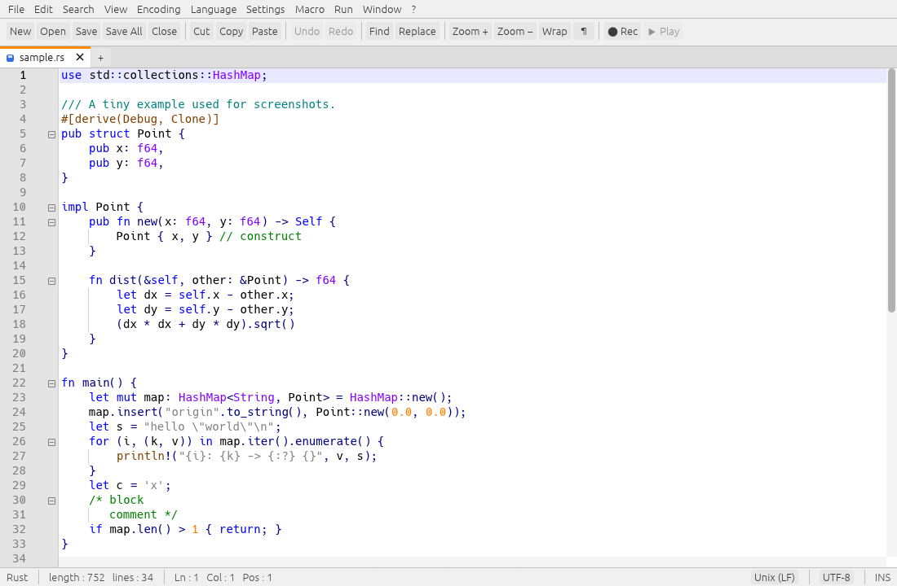

# RustPad

A fast, cross-platform source-code editor written in Rust, inspired by the feature set and
workflow of Notepad++ — tabs, syntax highlighting for 57 languages / formats (including SAP Commerce ImpEx and FlexibleSearch), powerful search and
replace, multi-caret editing, code folding, macros, session restore and much more.

It runs on **Windows, macOS and Linux** from a single code base (egui/eframe for the UI,
`ropey` for text storage).

> **Clean-room implementation.** RustPad was written from scratch. No Notepad++ source code
> (or any other editor's source) was read, copied or translated; behaviour was modelled on
> the editor's publicly visible user-facing features. The code is original.



## Features

**Editing**
- Tabs with drag-to-reorder, close buttons, save-state icons, context menu; split view (side-by-side / stacked)
- Multi-caret editing (`Ctrl+Click`), rectangular / column selection (`Alt+drag`, `Alt+Shift+arrows`), column editor with number sequences
- Unlimited undo/redo with typing coalescing, smart auto-indent, optional auto-close of brackets, quotes and HTML/XML tags
- Line operations: duplicate, delete, cut/copy, move up/down, join, split, transpose, sort (lexicographic / case-insensitive / numeric / random / reverse), remove duplicates / empty lines, trim whitespace, tabs ⇄ spaces, case conversion, comment toggling
- Code folding (braces, indentation, markup tags, block comments), bookmarks, brace matching, smart highlighting of the selected word
- Word wrap, indent guides, whitespace / EOL markers, edge column, zoom, full-screen and distraction-free ("Post-It") modes
- Word-based auto-completion (`Ctrl+Space`), document map (minimap), function list, folder-as-workspace tree

**Files & encodings**
- Detects UTF-8 / UTF-8 BOM / UTF-16 LE+BE (with or without BOM) and ~25 legacy code pages (Western, Central European, Cyrillic, Greek, Turkish, Hebrew, Arabic, Baltic, Vietnamese, Thai, Japanese, Korean, Chinese); convert or reload as any of them
- Preserves and converts line endings (Windows / Unix / classic Mac)
- Handles very large files (a 78 MB, 1,000,000-line file opens in ~150 ms)
- Hot-exit: unsaved buffers, caret positions and tabs are restored on the next launch
- Detects files changed or deleted on disk; recent files; drag & drop to open; `-nLINE` command-line option

**Search**
- Find / Replace / Find in Files / Mark dialogs; Normal, Extended (`\n \t \xNN …`) and Regular-expression modes (capture groups via `$1` or `\1`), whole-word, match-case, wrap-around, in-selection
- Find All (current document / all open documents / files on disk) with a clickable results panel, Replace in Files, incremental search, bookmarks and marks
- Go to line / offset

**Customisation**
- 5 built-in colour themes (Default, Dark, Monokai, Solarized Light/Dark) plus your own as JSON in `<config>/themes/`
- Shortcut Mapper to rebind every command; preferences dialog; macros (record, playback, run N times / until EOF, save by name)
- Run menu with variables (`$(FULL_CURRENT_PATH)`, …), hash generation (MD5, SHA-1, SHA-256, SHA-512)

## Build & run

```sh
cargo run --release                 # run
cargo run --release -- file.rs      # open files
cargo run --release -- -n42 file.rs # open and jump to line 42
cargo build --release               # binary in target/release/rustpad
```

Requires a recent stable Rust toolchain. No system libraries are needed to build on
Windows or macOS. On Linux, X11 or Wayland is needed at run time; native file dialogs use
the XDG desktop portal (install `xdg-desktop-portal-gtk` / `-kde` if dialogs do not appear).

Configuration lives in the platform config directory (`~/.config/rustpad` on Linux,
`~/Library/Application Support/rustpad` on macOS, `%APPDATA%\rustpad` on Windows):
`config.json`, `shortcuts.json`, `session.json`, `backup/` and `themes/`.

## Default shortcuts

The usual suspects: `Ctrl+N/O/S/W`, `Ctrl+Shift+S` save all, `Ctrl+F/H` find/replace,
`Ctrl+Shift+F` find in files, `F3` / `Shift+F3` next/previous, `Ctrl+G` go to, `Ctrl+D`
duplicate line, `Ctrl+L` cut line, `Ctrl+Shift+↑/↓` move line, `Ctrl+Q` toggle comment,
`Ctrl+U` / `Ctrl+Shift+U` lower / upper case, `Ctrl+F2`/`F2` bookmarks, `Alt+0` fold all,
`Ctrl+Shift+R` / `Ctrl+Shift+P` record / play macro, `F11` full screen, `Ctrl+wheel` zoom.
On macOS `Ctrl` is `Cmd`. See *Settings ▸ Shortcut Mapper* for the full list.

## Testing

```sh
cargo test                        # unit tests + randomised engine fuzzing (FUZZ_SEEDS=N for more)
tests/ui/run_ui_tests.py          # headless end-to-end UI tests (needs xvfb-run)
```

The UI tests drive the real application: the binary has a small input-replay hook
(`RUSTPAD_SCRIPT=<file>`, see `src/debug.rs`) that injects key / pointer events, dumps
buffer state and takes screenshots. `RP_TRACE=1` prints slow frames.

## Layout of the code

See [docs/ARCHITECTURE.md](docs/ARCHITECTURE.md).

## Known limitations

- Syntax highlighting is a fast, heuristic, data-driven lexer (keyword sets, comments, strings,
  numbers) — not a full grammar per language; embedded languages (e.g. JS inside HTML) are not highlighted separately.
- No plugin system (Notepad++ plugins are Windows-only DLLs built against Win32 and Scintilla, so they cannot be loaded), printing, hex editor, file-compare or user-defined-language editor.
- Carets move by Unicode scalar value, not by grapheme cluster; right-to-left text is not specially handled.
- Windows and macOS builds are compile-checked (`cargo check --target …`) but have not been run interactively; the end-to-end tests above run on Linux only.

## License

MIT — see [LICENSE](LICENSE).
