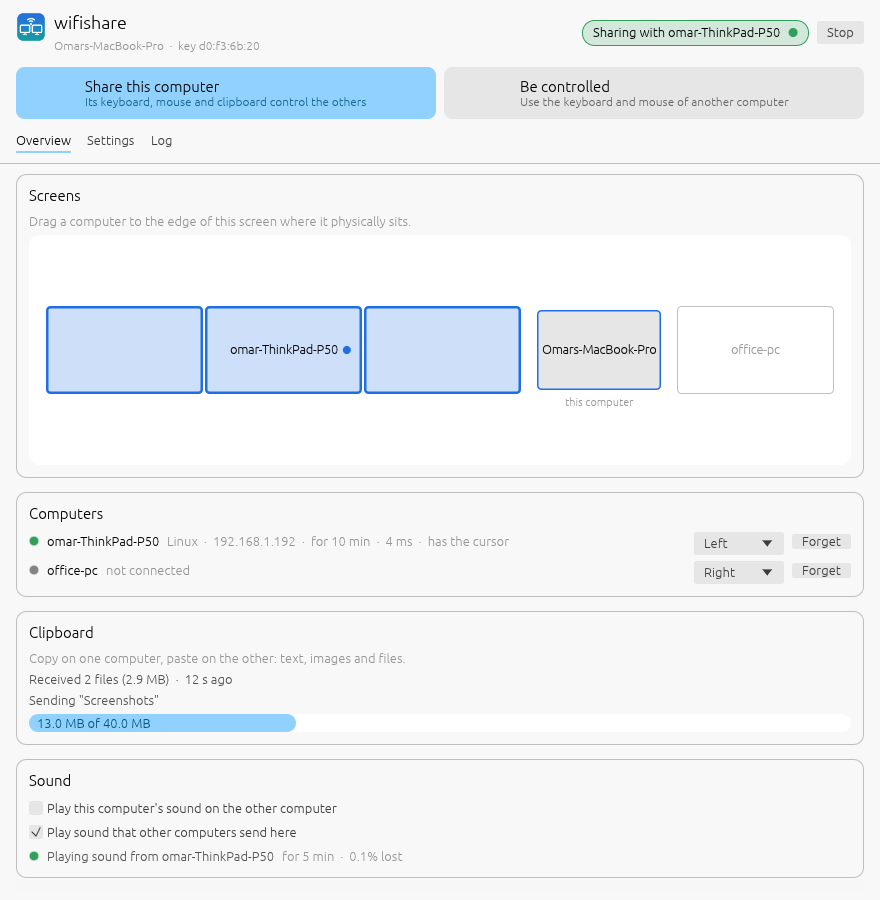
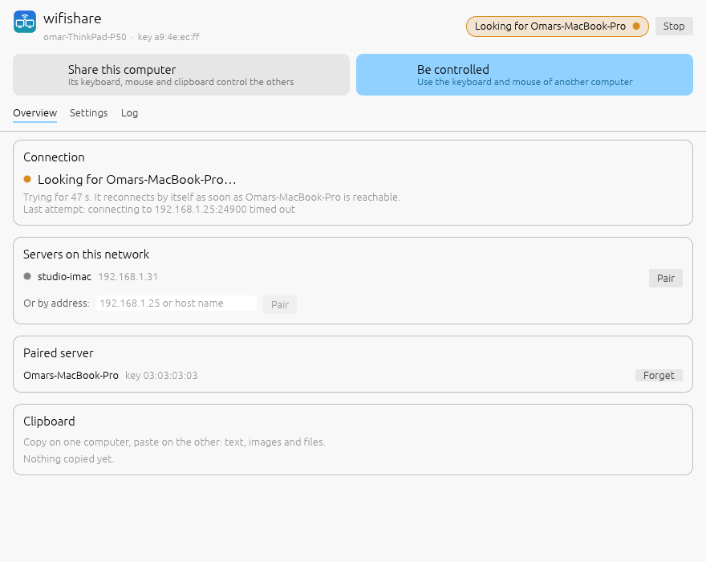

# wifishare

Use one keyboard and mouse across computers on the same network, Deskflow/Synergy style, with
the clipboard (text, rich text, images and files) shared both ways, and optionally one
computer's sound played on the other. It is built to survive
flaky Wi-Fi: take the server out of range, put it to sleep, or let it come back with a
different IP, and the client reconnects on its own within a second of the server reappearing.

It has a window for everyday use (status, screen arrangement, pairing, settings) and a
command line for scripting and headless machines.



| | macOS | Windows | Linux (X11 and Wayland) |
|---|---|---|---|
| Client (is controlled) | yes | yes | yes, via uinput |
| Server (shares its keyboard/mouse) | yes | yes | not yet (clipboard-only) |
| Clipboard sync | yes | yes | yes (X11/XWayland) |
| Send its sound to the other | not yet | not yet | yes (PipeWire/PulseAudio) |
| Play the other's sound | yes | yes | yes |

Tested here: the Linux client (uinput injection, GNOME Wayland) plus every networking and
clipboard path end to end. The macOS and Windows backends compile but have not run on real
machines yet, so expect rough edges there and please report them.

## Build

Rust 1.88 or newer (`rustup`), then in this folder:

```sh
cargo build --release          # binary: target/release/wifishare
```

CI (`.github/workflows/wifishare.yml`) builds macOS, Windows and Linux binaries and keeps them
as downloadable artifacts.

## Set up (macOS server, Ubuntu client)

1. **Quit Deskflow** on both machines so two tools are not fighting over the input.
2. **Mac:** run `wifishare` (no arguments opens the window) and choose **Share this computer**.
   macOS asks for **Accessibility** access for the app that started it (Terminal, if you
   launched it from there). The window has a button that opens that settings page. Enable it,
   then press Stop and Start. macOS 15+ may also ask to let it find devices on the local
   network: allow it, because that is how the client finds the Mac after an IP change.
3. **Ubuntu:** run `wifishare` and choose **Be controlled**. The Mac shows up under *Servers on
   this network*. Press **Pair**. Both windows show the same 6-digit code: confirm on Ubuntu,
   allow on the Mac. You only pair once.
4. **Mac:** in *Screens*, drag the ThinkPad to the side of the Mac's screen where it physically
   sits. The change applies immediately.

On Ubuntu, closing the window keeps wifishare running in the top bar (tray). Click the icon to
reopen it. Settings > Startup can start it at login and add it to the applications menu.

The Linux client needs write access to `/dev/uinput`. The window (or `wifishare info`) says
whether it has it and gives the one-time udev rule if not.



### Without the window

The same steps from a terminal: `wifishare server [--side left]` on the Mac (pairing requests
are approved in that terminal), `wifishare pair [192.168.1.25]` then `wifishare client` on
Ubuntu. Layout lives in `config.toml` (`wifishare init` writes a commented one):

```toml
[[server.clients]]
name = "omar-ThinkPad-P50"   # the client's host name
side = "left"                # left, right, top or bottom of the Mac's screens
```

For running without a desktop session, `packaging/` has a systemd user unit (Ubuntu client) and
a launchd agent (macOS server). Under launchd, grant Accessibility to the binary itself.

## How it stays connected

When a Deskflow server drops off the network, the client often stays stuck. The likely cause is
that the old TCP connection never errors out, so the server refuses the client's new connection
while it still believes the old one is alive. wifishare is built around that failure:

- **Heartbeats** both ways every second. A link silent for 4 s (`network.timeout_ms`) is
  dropped at once, and the client releases every key and button it was holding, so no Ctrl
  gets stuck. The server takes its cursor back if the client had it.
- **A reconnect replaces the old link.** The server never refuses a client because it thinks
  the client is still connected. If the client had control, it keeps it.
- **Never gives up, never waits long.** Backoff is capped at 2 s. Every attempt dials all known
  addresses at once: the configured host name (re-resolved each time), the last address that
  worked, and the latest discovery beacons.
- **Discovery.** The server broadcasts a beacon every second, plus one immediately when its
  network changes. The client also probes while disconnected. A beacon from the server ends any
  backoff, so the client reconnects as soon as the Mac is back, even on a new IP.
- **Network changes and sleep.** Both sides watch their own interfaces and notice waking from
  sleep. If the client's address disappears, it drops the link immediately instead of waiting
  for a timeout.
- **Wi-Fi priority.** Input packets are marked DSCP EF (Wi-Fi's voice queue) and bypass Nagle.
  Clipboard payloads travel on separate connections, so a large file copy never delays a mouse
  movement. Mouse moves that pile up behind a stall are merged into the latest position rather
  than replayed.

## Clipboard

Anything copied on either machine is available to paste on the other right away. Text keeps
its HTML formatting where the apps provide it, and images are sent as PNG.

**Files and folders** are sent when they are copied (up to `clipboard.max_files_mb`, default
2 GB). They land in a cache folder, and the clipboard on the other machine points at them, so
pasting in Finder/Nautilus/Explorer copies them from there. Only the last three received sets
are kept. A copy made while the machines were apart is re-sent when they reconnect, if it is
newer than what the other side has.

## Sound

On Ubuntu, tick **Play this computer's sound on …** in the window's Sound card (or set
`audio.send = true`). Everything Ubuntu plays then comes out of the Mac's speakers or
headphones, typically 50–100 ms later. That is fine for music, videos and calls, though lip-sync
may drift slightly.

- While sending, Ubuntu's own output is switched to a virtual "wifishare" device, so its
  speakers go quiet. Tick *Keep playing it here too* to hear it on both machines.
- When sending stops, or the Mac leaves the network, Ubuntu's previous output comes back. A
  small watchdog process restores it even if wifishare crashes.
- The sound is uncompressed 48 kHz stereo (about 1.5 Mbit/s, nothing silent is sent) over UDP,
  encrypted with a key agreed over the paired link. The Mac buffers `audio.buffer_ms` (40 ms by
  default) to ride out Wi-Fi hiccups; raise it if the sound crackles on a busy network.

## Keyboard

Keys are sent as physical key positions, so the receiving machine's keyboard layout decides
the character. Between a Mac and a non-Mac, **Cmd and Ctrl are swapped** by default, so Cmd+C
on the Mac keyboard is Ctrl+C on Ubuntu. Turn it off with `swap_cmd_ctrl = false` under
`[server]` or per client.

## Security

Machines pair once, comparing a 6-digit code derived from a Noise (`XX_25519_ChaChaPoly`)
handshake, so nobody in the middle can impersonate either side. After that, only paired keys
are accepted and everything (keystrokes included) is encrypted. Keys live in the config folder
(`identity.key`, `peers.toml`). `wifishare forget <name>` unpairs a machine.

## Commands

```
wifishare                 # open the window (same as `wifishare gui`)
wifishare server [--side left|right|top|bottom] [--no-input]
wifishare client [SERVER]
wifishare pair [SERVER]
wifishare info            # key, paired machines, monitors, permission problems
wifishare init            # write a commented config.toml
wifishare forget NAME
wifishare test-inject     # move the pointer in a square to check injection
```

Add `-v` for debug logging. `--config-dir DIR` keeps everything in one folder, for running
several instances on one machine.

## Known limits

- Linux cannot be a server yet: capturing input on Wayland needs the InputCapture portal.
- The Windows server leaves the cursor visible, parked in the middle of the screen, while a
  client is in control.
- macOS ignores event taps while a password field has Secure Input on. Typing a password on the
  Mac itself is unaffected, but keys do not reach the client during that time.
- Media keys (volume, play) on the Mac keyboard still act on the Mac.
- Sound goes from Linux to the others only. Sending a Mac's or a Windows PC's sound is not
  built yet, and neither is microphone sharing.
- The tray icon exists on Linux only. On macOS and Windows, closing the window quits; leave it
  open or minimized while sharing.

## Tests

```sh
cargo test               # switching logic, key tables, encryption, framing, dead-link detection, pairing
WIFISHARE_SHOTS=dir cargo test gui::tests -- --ignored   # render the window to PNGs, headless
scripts/run_e2e.sh       # Linux/macOS: two local instances, file-backed clipboards, logged input
```

The end-to-end script pairs two instances, then checks clipboard text and files both ways, a
large clipboard over a bulk connection, a frozen server (detected, reconnected, still syncing),
replay after a restart, and finding the server by its beacon alone.
